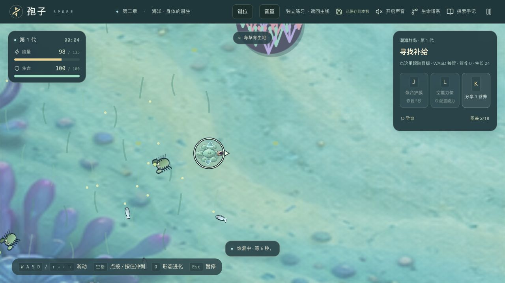

# 孢子 · 生命进化冒险

从一滴水里的微小生命开始，探索池塘、海洋、潮间带与陆地，留下祖源，改变身体，建立早期族群，再从真实祖先培育另一支系。

**[下载 Mac / Windows 离线试玩版](https://github.com/LanCloudLance/spore-evolution/releases/tag/v0.1.0-offline)**



## 离线开始玩

| 电脑 | 下载文件 | 解压后启动 |
| --- | --- | --- |
| Windows 10 / 11，Intel / AMD 64 位 | `spore-offline-windows.zip` | 双击 `启动孢子.exe` |
| macOS 12+，Apple 芯片 / Intel | `spore-offline-mac.zip` | 双击 `启动孢子.command` |

先完整解压，再启动。无需联网或安装 Node / Python。请保留启动窗口，游戏会在默认浏览器打开；也可在 Edge / Chrome 中输入 `http://127.0.0.1:49325/`。

游戏、美术、五段生境配乐均包含在离线包内。声音默认关闭，点声音按钮开启，再通过“音量”分别调节音乐和音效。游戏中的科学资料外部链接需要联网。

每 5 秒自动保存，也可点顶部存档按钮立即保存。使用同一浏览器用户和普通窗口可以继续进度；移动整个游戏文件夹不改变存档地址。换电脑、换浏览器、使用无痕窗口或清理浏览器数据会影响存档。主线与海洋独立练习分别保存。

## 操作

左手移动，右手动作；顶部“键位”说明会随章节显示适用操作。

| 按键 | 操作 |
| --- | --- |
| WASD / 方向键 | 移动；也可用鼠标指向 |
| 空格 / Shift | 冲刺 / 潜行 |
| J | 身体技能 / 第一能力 |
| K | 分享、采集、筑巢等情境互动 |
| L | 第二能力 / 指挥伙伴 |
| U | 使用学会的 DNA 能力 |
| I | 陆地结构动作 |
| O | 查看与孕育下一代 |
| Esc | 暂停 / 继续，或关闭打开的设置面板 |

动作取决于当前身体与章节；技能冷却或条件不足时会显示原因。打开设置、手记或谱系会暂停，关闭后由玩家明确继续。

## 当前内容

- 微生物 → 海洋 → 潮间带登陆 → 陆地 → 早期族群 → 保存成果 → 从祖先培育另一支系。
- 捕猎、滤食 / 育园、共生等行为留下真实来源；来源影响后代身体、能力、成本与路径。
- 海洋与陆地各有 6 个生境、18 个物种及 12 种器官或来源结构；保留跨阶段身体、来源与真实谱系。
- 伙伴、领地、环境事件、幼体与族群分工形成生物篇循环；保留现有科技入口。

游戏压缩了世代与时间，生物和器官组合是幻想模型。吞食获取 DNA、主动选择后代能力等玩法不表示真实物种之间的祖先关系，也不表示变异会按需要定向产生。

## 验证范围

工程检查覆盖玩家规则、跨阶段继承、来源结算与存档；本机已检查多条完整生物路线、离线操作和保存重启。最新自动检查结果可在 [GitHub Actions](https://github.com/LanCloudLance/spore-evolution/actions) 查看。

Windows 原生启动器的运行检查使用 GitHub 的 Windows 环境。目标玩家电脑的双击、默认浏览器调用、主观听感与手感仍需要实际试玩，不能把自动检查当作最终玩家验收。公开版是可下载的试玩版本。

## 从源码运行

开发机需要 Node.js 22.13+（建议 24），然后在仓库根目录执行：

```sh
npm ci
npm run dev -- --host 127.0.0.1 --port 3000
```

打开 `http://127.0.0.1:3000/`；`/ocean` 是海洋独立练习。源码预览与离线启动器使用不同地址，存档不会自动迁入。

```sh
node --experimental-strip-types --test --test-concurrency=4 tests/*.test.ts
npx tsc --noEmit
npx oxlint app/game tests offline/*.tsx scripts/*.mjs
npm run build
```

生成器附带的公共 UI / hooks 仍有既有全仓 lint 错误；上面的范围检查针对游戏与本次交付代码。

## 构建离线包

```sh
npm run build:offline
node scripts/verify-offline.mjs
npm run package:offline:mac
npm run package:offline:windows
```

单文件输出在 `outputs/offline/`。Mac 包需要在 macOS 上使用系统 Swift 工具链构建；Windows 包需要 Go 编译器，可通过 `SPORE_GO` 指定路径。两种 ZIP 的构建还需要 Python 3。这些工具只用于开发与打包，玩家无需安装。

Canvas 2D 模拟与 React 展示分离；本项目没有玩家账号服务器。目录：`app/game/` 玩家规则与界面，`tests/` 回归测试，`public/` 素材与配乐，`offline/` 离线适配和启动器，`scripts/` 构建与检查工具。

## 素材与第三方许可

绿草履虫照片由 Cucumberkvp 创作并公开至公有领域，保留原图与来源：[Wikimedia Commons](https://commons.wikimedia.org/wiki/File:Paramecium_Bursaria.jpg)。配乐合成谱与生成脚本保留在仓库。第三方软件许可见 `THIRD_PARTY_NOTICES.txt`，离线 ZIP 内也附有许可说明。
